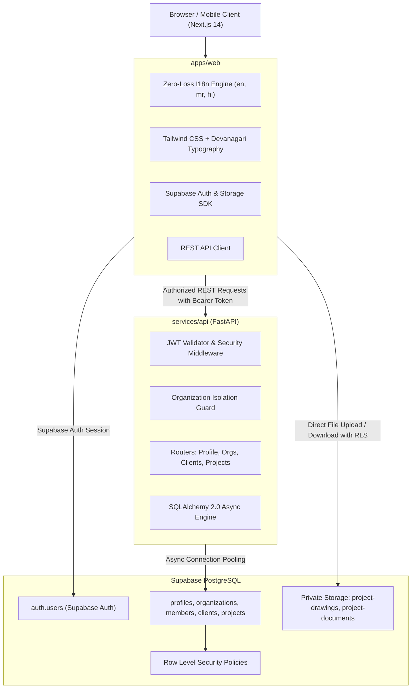

# अनुमान (Anumaan) — System Architecture

**Official Tagline**: *मिनटों में पूरा अनुमान।*  
**Brand Identity**: Professional, multilingual construction estimation and quotation SaaS for Indian civil engineers, contractors, and quantity surveyors.

---

## 1. High-Level Architecture Overview

---

## 2. Core Architectural Principles

### 2.1 Multilingual-First Architecture (English, Marathi, Hindi)
1. **Zero-Loss Locale Switching**: Language changes happen client-side via React Context without full page refreshes. Active form inputs (e.g. project descriptions, quantities) are preserved completely while all labels, placeholders, and UI elements transition immediately.
2. **Deterministic Translation Parity**: Translation dictionaries (`messages/en.json`, `messages/mr.json`, `messages/hi.json`) are structured symmetrically. An automated Vitest suite guarantees 100% key parity across all three languages.
3. **Database Language Independence**: All internal enum values (e.g. `project_type: 'building' | 'road'`, `status: 'planning' | 'in_progress' | 'completed' | 'archived'`) are stored in canonical English strings. User-entered names and descriptions support full UTF-8 Unicode characters for natural Marathi, Hindi, and English input.
4. **Quotation Output Readiness**: Projects store an independent `quotation_language` attribute (`en`, `mr`, `hi`), decoupling the interface language from the final quotation document language.

### 2.2 Multi-Tenant Organization Isolation
1. **Multi-Tenancy Model**: Every user belongs to one or more organizations via `organization_members` with roles (`owner`, `admin`, `member`).
2. **Dual-Layer Defense**:
   - **Database Layer**: Row Level Security (RLS) policies on every organization-owned table prevent any unauthorized read or write operations at the database level.
   - **API Layer**: FastAPI dependencies (`verify_org_membership`, `verify_org_admin`) strictly validate that the authenticated user has active membership in the target organization before querying or mutating data.
3. **Cross-Tenant Client Isolation Constraint**: A composite foreign key constraint `(organization_id, client_id) REFERENCES clients(organization_id, id)` mathematically guarantees that a project cannot reference a client belonging to a different organization.

---

## 3. Technology Stack Reference

| Layer | Technology | Purpose |
| :--- | :--- | :--- |
| **Frontend Framework** | Next.js 14 (App Router) | Server-rendered & client-interactive modern React framework |
| **Language** | TypeScript (Strict Mode) | Type safety across API schemas, props, and translation keys |
| **Styling** | Tailwind CSS | Design tokens: Warm beige, charcoal black, muted gold, warm grey |
| **Icons** | Lucide React | Clean, architectural iconography |
| **Devanagari Font** | Noto Sans Devanagari | Crisp rendering for Hindi and Marathi without layout overflows |
| **Backend API** | Python 3.14 + FastAPI | High-performance asynchronous REST API |
| **Validation** | Pydantic v2 | Request/response schema validation and type coercion |
| **ORM & Database** | SQLAlchemy 2.0 Async + asyncpg | Production connection to PostgreSQL; aiosqlite for tests |
| **Auth & Storage** | Supabase Auth + Supabase Storage | Secure JWT authentication & private project bucket storage |
| **Frontend Testing** | Vitest + React Testing Library | I18n completeness, form state persistence, component unit tests |
| **Backend Testing** | Pytest + pytest-asyncio + HTTPX | Auth verification, multi-tenant isolation, CRUD lifecycle tests |
