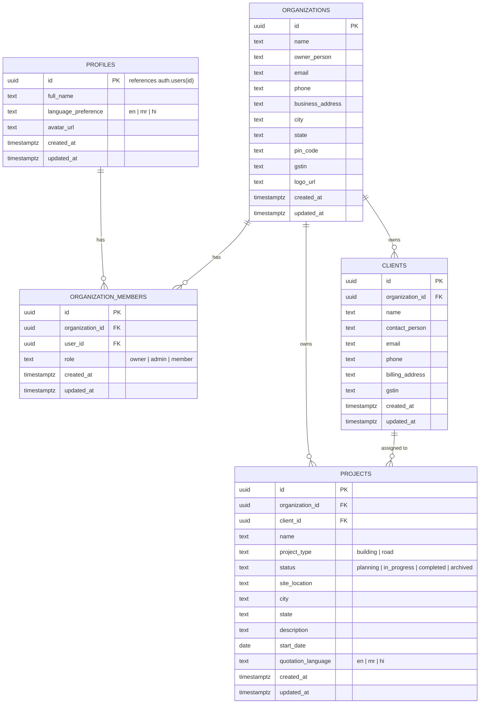

# अनुमान (Anumaan) — Database & Security Model

## 1. Relational Database Schema

The database model is defined via versioned SQL migrations in `supabase/migrations/`:



---

## 2. Row Level Security (RLS) Policies

All tables have Row Level Security enabled (`ALTER TABLE ... ENABLE ROW LEVEL SECURITY`). Access is restricted using stable, security-definer helper functions:

```sql
CREATE OR REPLACE FUNCTION public.is_org_member(target_org_id UUID)
RETURNS BOOLEAN AS $$
BEGIN
    RETURN EXISTS (
        SELECT 1 FROM public.organization_members
        WHERE organization_id = target_org_id
          AND user_id = auth.uid()
    );
END;
$$ LANGUAGE plpgsql STABLE SECURITY DEFINER SET search_path = public;
```

### Table Security Rules

1. **`profiles`**:
   - `SELECT`: `id = auth.uid()`
   - `UPDATE`: `id = auth.uid()`
2. **`organizations`**:
   - `SELECT`: `public.is_org_member(id)`
   - `INSERT`: `auth.uid() IS NOT NULL`
   - `UPDATE`: `public.is_org_admin(id)`
3. **`organization_members`**:
   - `SELECT`: `public.is_org_member(organization_id)`
   - `INSERT`: `public.is_org_admin(organization_id)` or self-enrollment as initial `owner`
   - `UPDATE` / `DELETE`: `public.is_org_admin(organization_id)`
4. **`clients`**:
   - `SELECT` / `INSERT` / `UPDATE`: `public.is_org_member(organization_id)`
   - `DELETE`: `public.is_org_admin(organization_id)`
5. **`projects`**:
   - `SELECT` / `INSERT` / `UPDATE`: `public.is_org_member(organization_id)`
   - `DELETE`: `public.is_org_admin(organization_id)`

---

## 3. Storage Bucket Security

Two private Supabase storage buckets are configured:
- `project-drawings` (up to 50MB per file: PDF, PNG, JPG, DWG, SVG)
- `project-documents` (up to 25MB per file: PDF, XLSX, DOCX, JPG, PNG)

### Path Convention & RLS:
Objects must be stored following the hierarchical key structure:
`/{organization_id}/{project_id}/{filename}`

Storage RLS enforces that `(storage.foldername(name))[1]::uuid` matches an organization where `auth.uid()` has verified membership.

---

## 4. API Authorization & JWT Security

1. **Bearer Token Validation**: Every request to the FastAPI backend requires `Authorization: Bearer <token>`. The backend validates the Supabase HS256 signature using `SUPABASE_JWT_SECRET` and checks token expiration.
2. **Untrusted Client Identifiers**: The backend never accepts an `organization_id` header or URL parameter blindly. It queries the membership table before every operation. If a user attempts to access an organization they do not belong to, an HTTP 403 Forbidden is returned.
3. **Secret Hygiene**: The Supabase Service Role key (`SUPABASE_SERVICE_ROLE_KEY`) is strictly confined to the backend environment and never bundled or exposed in client-side code.
